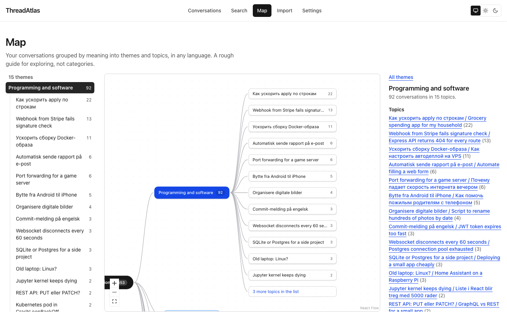
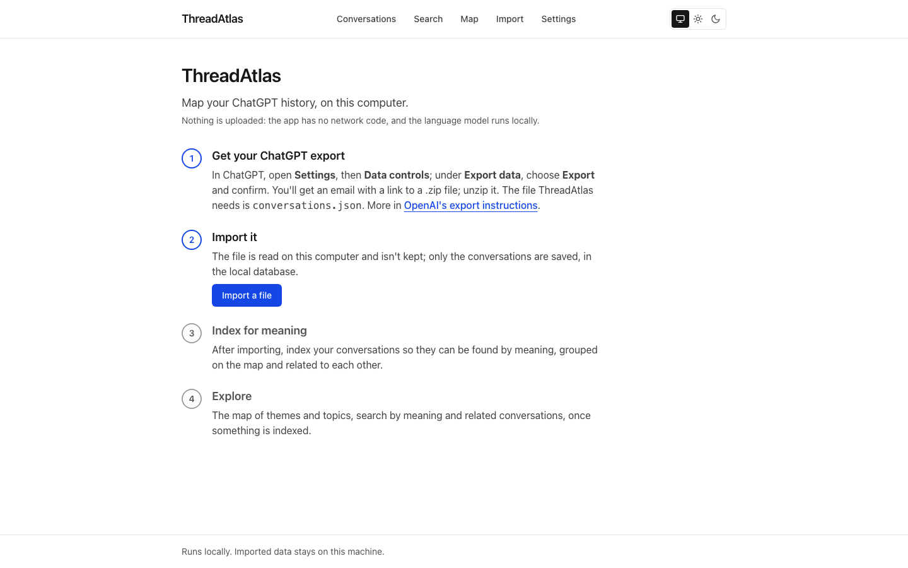
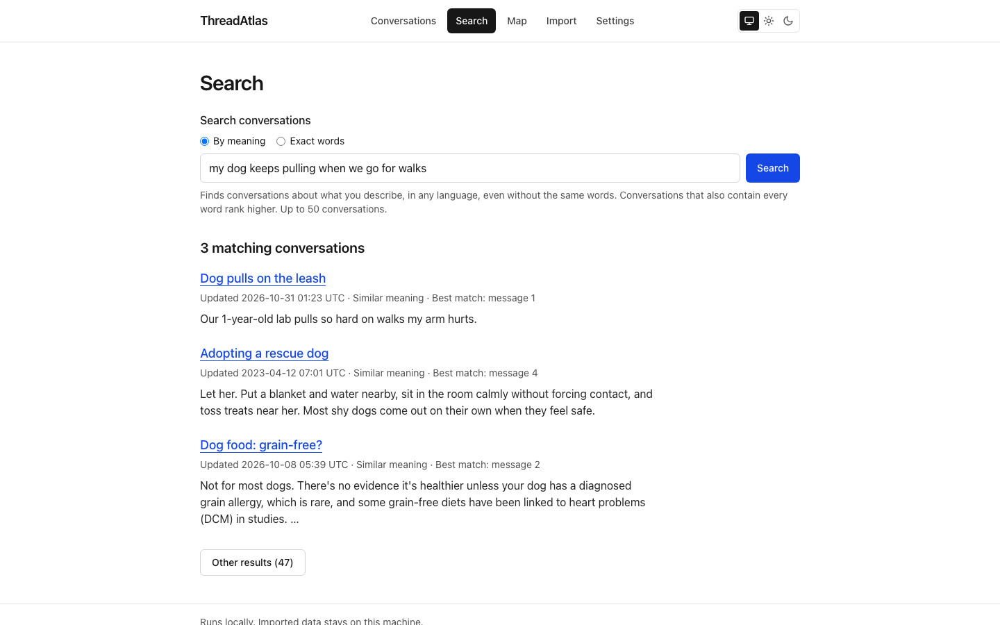
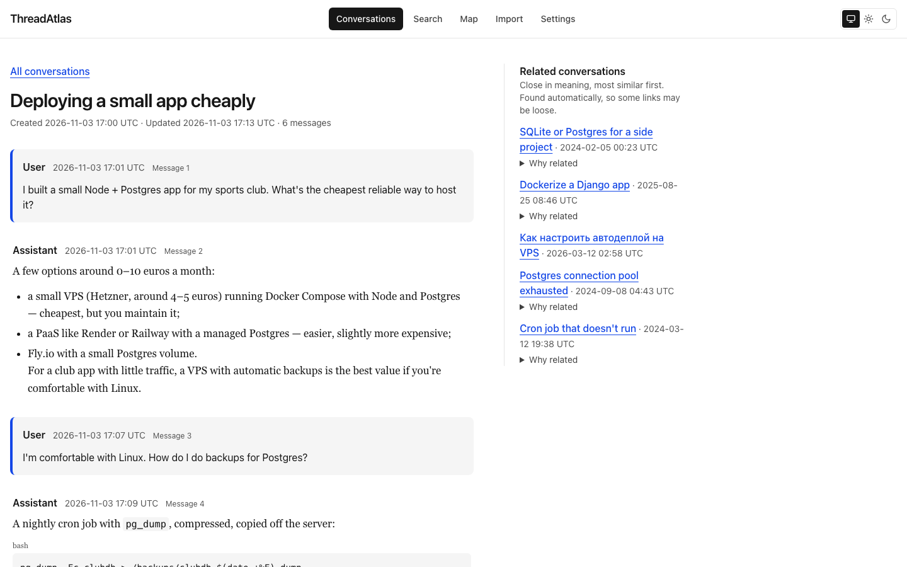
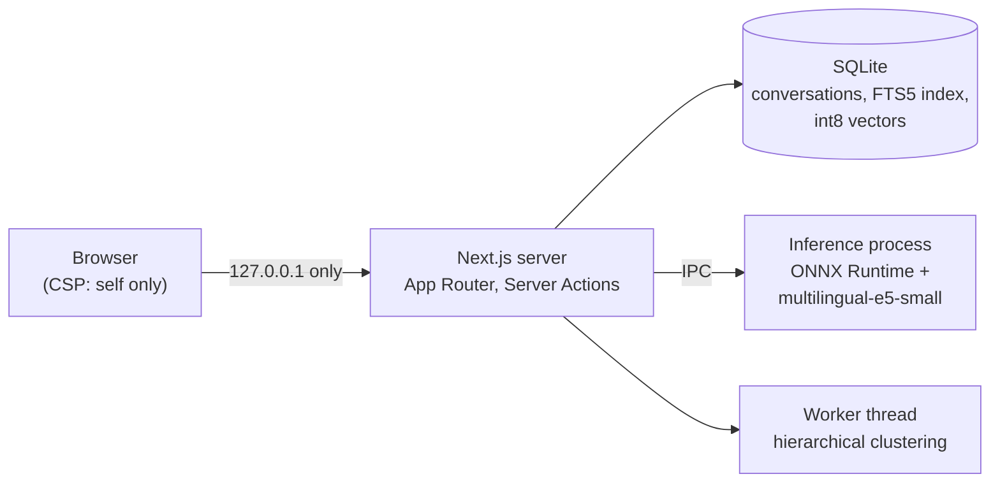

# ThreadAtlas

**A private, local-first atlas of your ChatGPT history.** Import the official ChatGPT export,
read your conversations comfortably, search them by keyword or by meaning, and explore them as a
map of themes and topics. The search and map use a small multilingual model that runs on your
own computer, and nothing you import leaves it.



## Why

After a few years, a ChatGPT history is an archive you can't navigate. The sidebar lists titles
by date, search matches exact words, and one subject is spread over dozens of threads, often in
several languages. ThreadAtlas turns the export into something you can browse and rediscover,
without uploading a private archive to yet another service.

## Features

- **Guided first run:** the home page walks through export → import → indexing → exploring, and
  checks each step off from the archive's actual state.
- **Import** that tolerates format changes. Branching threads are rebuilt along the path that was
  open in ChatGPT, and re-importing a newer export updates changed conversations without
  duplicating anything ([import-format.md](docs/import-format.md)).
- **Reading:** your messages are shown as typed. Assistant replies are rendered from Markdown by
  a small, safe renderer, with related conversations beside them on wide screens.
- **Keyword search** (SQLite FTS5) with accent folding, highlighted snippets and links to the
  matching message.
- **Search by meaning** in any of the archive's languages, combined with exact-word matches.
- **Map:** conversations grouped into themes and topics in a synchronized outline, map and panel.
  The selection is kept in the URL, everything works from the keyboard, and phones get a list
  first.
- **Related conversations** for each conversation, each with a passage from both sides that
  explains the link.
- **Delete everything** in one step, including the search indexes, followed by a file compaction.

| First run | Search by meaning | Reading |
| --- | --- | --- |
|  |  |  |

The screenshots show synthetic conversations written for testing.

## How it works



| Layer | Technology |
| --- | --- |
| App | Next.js 16 (App Router, Server Actions), React 19, TypeScript (strict), Tailwind CSS 4 |
| Storage | SQLite through Prisma 7 and better-sqlite3; FTS5 for keyword search |
| Embeddings | `multilingual-e5-small` (ONNX, pinned and checksummed), ONNX Runtime in a child process |
| Map | React Flow, with clustering in a worker thread |
| Tests | Vitest (unit, integration, real model), Playwright (end-to-end) |

- **Embeddings:** messages are split into chunks of up to 64 tokens. Each chunk becomes a
  384-dimensional vector, stored as int8 (388 bytes) with its message and character offsets. No
  message text is duplicated. Inference runs in a separate process, so a native crash can't take
  the server down. Vectors are searched in memory, with no vector database
  ([ADR 0002](docs/adr/0002-local-semantic-retrieval.md)).
- **Hybrid search:** a conversation scores its best passage. Each passage's score is reduced by
  half its average similarity to about 150 everyday subjects, so generic text doesn't crowd out
  real matches. When the exact words also match, the meaning and keyword rankings are fused by
  reciprocal rank fusion (k = 60). Results are split into close matches and other results.
- **Hierarchical clustering:** each language's average vector is subtracted first, because
  language is the strongest signal in these vectors. Conversations on one subject in English,
  Norwegian and Russian can then meet. One average-linkage tree is cut twice: into topics, and
  into at most 15 themes. Themes are named from a vocabulary matched by the model, topics by
  their two most typical titles.
- **Evaluation:** every setting was chosen on synthetic research sets and checked on a held-out
  one. A selection of results:

  | Measure (synthetic data) | Result |
  | --- | --- |
  | Search by meaning, nDCG@10 (v0 / long / held-out v2) | 0.852 / 0.866 / 0.596 |
  | Map grouping, B³ F on the held-out set: hierarchical vs the earlier k-means | 0.53 vs 0.16 |
  | Related conversations: share of wrong links at the 0.35 threshold | about 8% |

  Data sets, method and how to reproduce them: [evaluation.md](docs/evaluation.md).

## Privacy and local-first design

- **Nothing leaves the machine.** The app has no network code, Next.js and Prisma telemetry is
  off, and a strict Content-Security-Policy (`'self'`) stops rendered content from contacting
  other hosts.
- **Local only:** the server binds to `127.0.0.1` and refuses other `Host` headers, which blocks
  DNS-rebinding attacks.
- **Untrusted content:** imported messages are never rendered as HTML, links work only to
  `http`, `https` and `mailto`, and images are never loaded.
- **Search terms** stay out of URLs, browser storage and logs.
- **Testing never touches your data:** tests run on temporary databases only, behind a path
  guard. Fixtures are synthetic, and the browser tests fail on any request to a non-local host.
- **The one download** ThreadAtlas makes is the model, and only when you run
  `npm run model:fetch`. Every outbound request made by the app or its tooling is listed in
  [privacy.md](docs/privacy.md).

## Installation

Requirements: Node.js 24+ and npm 11+, on macOS or Linux (Windows through WSL).

```bash
npm ci                            # exact dependency versions
npm run db:deploy                 # create the local database (data/threadatlas.db)
npm run model:fetch               # download and verify the model (135 MB), for search and the map
npm run build && npm run start    # http://127.0.0.1:3000
```

Then follow the steps on the home page:
1. **Export** your ChatGPT data: Settings → Data controls → Export data, as described in
   [OpenAI's instructions](https://help.openai.com/en/articles/7260999-exporting-your-chatgpt-history-and-data).
2. **Import** `conversations.json` on the Import page.
3. **Start indexing** there.
4. **Open the map.**

After installation everything runs offline. The model can also be installed from a local copy
(`npm run model:fetch -- --from <folder>`), and the app without it still imports, reads and
searches by keyword. `npm run dev` starts a development server. Details, including the four
dependency install scripts that npm approves, are in [development.md](docs/development.md).

## Tests

- **About 1,760 Vitest tests** cover unit and integration cases on temporary databases: import
  validation and data integrity, crash recovery with killed child processes, search, indexing,
  and Markdown security (hostile URLs and messages, plus 2,000 random hostile messages).
- **95 Playwright end-to-end tests** run against a production build. They cover the full
  first-run flow, keyboard navigation, 200% zoom, phone widths, reduced motion, forged requests
  and DNS rebinding, and every page fails on a console error or a non-local request.
- **24 real-model tests** (`npm run test:model`) check the vectors against reference outputs and
  the search relevance bars.
- **CI** runs the check and end-to-end jobs on GitHub Actions; the model tests are opt-in.

`npm run check` runs typecheck, lint and the Vitest suites; `npm run test:e2e` runs the
browser tests. More in [development.md](docs/development.md#testing).

## Limitations

- **Groupings and thresholds were tuned on synthetic data.** The map and related conversations
  still need checking on a real archive, and theme names are English only.
- **The small model** handles cross-language searches buried in long conversations least well.
  Exact words still find them.
- **First map after a restart:** about 6 s with 3,000 conversations, during which other pages
  can wait up to 1.5 s. Later visits take about 30 ms.
- **Markdown** covers the common subset; footnotes, maths and raw HTML stay as text.
- **Other branches** of a conversation are marked but can't be opened yet.
- **Tested** in Chromium only. Not tested with a real screen reader, Safari or Firefox.

The full list: [limitations.md](docs/limitations.md).

## Documentation

- [Using ThreadAtlas](docs/guide.md): every part of the app, Markdown support included
- [Evaluation](docs/evaluation.md): data sets, results and how to reproduce them
- [Privacy](docs/privacy.md): the design and every outbound request
- [Development](docs/development.md): scripts, test suites, CI
- [Import format](docs/import-format.md): how exports are parsed, and the visible path through
  branches
- [Architecture decisions](docs/adr/), [progress and main decisions](docs/PROGRESS.md),
  [implementation plan](docs/IMPLEMENTATION_PLAN.md), experiments in [docs/spikes](docs/spikes/)

ThreadAtlas was built with Claude Code as a pair programmer. `CLAUDE.md` holds the working
agreement, and the plans and spikes record how decisions were made.

## Licence and credits

ThreadAtlas is released under the [MIT License](LICENSE).

- **Embedding model:** [`intfloat/multilingual-e5-small`](https://huggingface.co/intfloat/multilingual-e5-small)
  (MIT) by Liang Wang et al., *Multilingual E5 Text Embeddings: A Technical Report*
  (2024), used as the ONNX conversion
  [`Xenova/multilingual-e5-small`](https://huggingface.co/Xenova/multilingual-e5-small) at the
  revision pinned in `src/lib/semantic/model-manifest.ts`. The model isn't part of this
  repository; `npm run model:fetch` downloads it.
- **Libraries:** Next.js, React, Prisma, better-sqlite3, ONNX Runtime, Hugging Face
  Tokenizers, React Flow, Zod and Tailwind CSS, each under its own licence (MIT or
  Apache-2.0; see `node_modules/<package>/LICENSE`). Next.js can install the optional image
  library `sharp`, whose native `libvips` build is LGPL-3.0; npm installs it from the
  registry and this repository doesn't include it.
