# ThreadAtlas UI/UX baseline review (2026-11-18)

> **Historical.** This review describes the interface before the changes it led to (2026-11-19):
> the map-first layout, keyboard access, the guided first run and the reading layout. Its
> screenshots show the old interface. The current state is in the [README](../../../README.md)
> and [PROGRESS.md](../../PROGRESS.md).

Report only: nothing in the interface was changed. Findings are ranked by their effect on the
goal "the map is the main way to explore". Every screenshot shows **synthetic data only**.

## Summary

1. **The map isn't ready to be the main interface yet.** On the default map, topic names are
   keyword triples taken from single languages, stopwords included ("как · при · сколько",
   "barn · drikke · etter"). The groups mix unrelated subjects: "bathroom · cold · dinner"
   holds dog training, cycling, coffee and houseplants. The experimental *Topics* view groups
   far better (English, Norwegian and Russian together), but it is a 94-row list with no map.
2. **The map works poorly with a keyboard.** The first 12 Tab stops inside it are invisible
   edges, announced as "Edge from root to topic:t1". Each topic then takes two Tab stops.
   React Flow's default help text tells screen-reader users to "press delete to remove" nodes.
3. **The map forgets where you were.** An opened topic closes when you go to a conversation and
   press Back, and on reload. Opening a large topic zooms out until titles are about 5 px tall,
   and the animation ignores reduced motion.
4. **The map doesn't fit small or zoomed screens.** At 375 px the navigation wraps to three
   rows, and the map starts below 70% of the first screen. At 200% zoom it doesn't appear on
   the first screen at all.
5. **The conversation page puts related conversations ahead of the conversation.** On a phone
   the first message starts below the first screen (965 px down, on an 812 px screen).
   Messages are identical bordered cards, and Markdown is shown as raw text.
6. **First run is a sequence of disconnected pages.** The home page has one link. After an
   import, the only next step offered is "View conversations". The step everything else
   depends on, indexing, sits further down the page, and the model download is a terminal
   command.
7. **Search reads well, but density and the reason for each match need work.** About 3 results
   fit per desktop screen. Every match says only "Similar meaning", and "Other results (41)"
   isn't explained.

What already works well:
- the pages render correctly at every width and in both themes, with no horizontal overflow;
- the skip link, landmarks, live regions and focus handling in the forms;
- the list view of the map, a solid accessible fallback built on native disclosure widgets;
- no external requests in any run (the walkthrough blocked and logged them; none were made).

## How it was run

- **Data:** the 453 hand-written synthetic conversations of the mind-map v2 spike (English 252,
  Norwegian 113, Russian 88; messy titles included), converted into a ChatGPT-shaped export.
  There was also a 3,000-conversation archive made of the same conversations plus scaled
  copies (new ids, shifted dates, title suffixes such as "(follow-up)"), used for layout and
  timing only. The suffixes leak into its map labels ("follow-up · hvor · again"), so it says
  nothing about grouping quality.
- **App:** production build (Next.js 16.4.6) on temporary databases in the system temp folder,
  with the real local model (`multilingual-e5-small`). Import and indexing went through the UI,
  the way a user would do them.
- **Measured** on an Intel Mac (a single run each, so treat the numbers as rough):

  | Step | 453 conversations | 3,000 conversations |
  | --- | --- | --- |
  | Import | 3.4 s | 17.6 s |
  | Indexing | 25 s | 3 min 51 s |
  | Map page load | — | 1.6 s, recomputed on every visit, including Back |
  | Topics view load | — | 4.3 s, about 13,000 page elements |
  | Search by meaning | — | 1.8 s |
  | Search by exact words | — | 0.07 s |

- **Screenshots:** Playwright Chromium at 375×812 (mobile), 768×1024 (tablet) and 1280×800
  (desktop), each in light and dark, for every page in four states: empty, imported, indexed,
  and the large archive. There are 150 in total; the 18 below are a selection, compressed.
- **Keyboard and accessibility:** a scripted Tab walk through the map and the conversation page,
  Back-navigation state, React Flow's own accessibility attributes, reduced motion, and 200%
  zoom (640 px CSS width).
- **Not covered:** a real screen reader (VoiceOver), Safari and Firefox, touch devices,
  Windows high-contrast mode, and an automated contrast scan (axe-core would need dependency
  approval). Contrast below was calculated for specific colour pairs.
- **Code audit:** the pinned skill `.claude/skills/web-interface-review` (Vercel's guidelines at
  `434b7f9`, plus the React Flow checklist). Full results in Appendix A.

## Findings, prioritised

P1 means it blocks "map first"; P2 is a significant usability or accessibility problem; P3 is
polish. Effort is S (hours), M (a day or two) or L (several days, or needs a product decision).

### P1 — Mind map

| # | Finding | Evidence | Proposal | Effort |
| --- | --- | --- | --- | --- |
| M1 | Default topic names are keywords from one language, stopwords included ("как · при · сколько", "helg · hvem · pakke"). Groups split by language and mix unrelated subjects. | 01, 06 | A product decision: make the language-corrected hierarchical topics the map's data (the v2 spike's recommendation), as **themes, each with topics** (two levels), not 94 flat rows. Name each node after its most typical conversation title, not a keyword triple. Keep k-means behind a setting until a real archive confirms the change. | L |
| M2 | Keyboard: 12 invisible, unlabelled edge stops before the first topic, then 2 stops per topic; default React Flow help mentions moving and deleting. | 05; tab walk | `edgesFocusable={false}`, `nodesFocusable={false}` (the inner buttons and links stay focusable), and an `ariaLabelConfig` that describes what you can actually do. Arrow keys move between topics, Enter opens and Esc closes. | S–M |
| M3 | State is lost: an opened topic closes after Back and on reload; selection isn't in the URL. | Back test: 0 open after Back | Put the selection in `?topic=` (the list view already has `?open=`). Restore it and focus it on return. | S |
| M4 | Opening a topic zooms out to 0.4×, so titles are about 5 px; the animation ignores reduced motion. | 02, 04 | Show the opened topic's conversations in a side panel (wireframe A), not as 20 tiny nodes. Keep the zoom readable (`minZoom` around 0.6 for fitView). Use `duration: 0` under `prefers-reduced-motion`. | M |
| M5 | Mobile and 200% zoom: the header wraps to 3 rows; the canvas starts 595 px down a 812 px screen and captures touch panning. | 03, 18 | Below 640 px, show the outline by default, with "Show map" as an option. Use a compact header (wordmark plus a menu). | M |
| M6 | Scale: always 12 topics (about 250 conversations each at 3,000), 20 of them shown per topic. Each visit recomputes the map (1.6 s), and the Topics view takes 4.3 s and renders all 3,000 titles in collapsed lists. | 08; timings | A two-level hierarchy (M1) keeps each level small. Cache the computed map per index version. Render a topic's conversations only when it's opened. | M |
| M7 | Two stacked rows of tabs ("Current map / Topics (experimental)", then "Map / List") plus three explanation paragraphs come before the canvas. | 01, 07 | One view switch, *Map / Outline*. Move the method notes into a "How topics are made" disclosure. | S |

### P2 — Conversation page and related conversations

| # | Finding | Evidence | Proposal | Effort |
| --- | --- | --- | --- | --- |
| C1 | Related conversations come before the messages: the first message starts 627 px down on desktop and 965 px down on mobile. | 11, 12 | On ≥ 1024 px, a "Nearby" rail beside the reading column. Below that, a collapsed "Nearby (5)" line under the title (wireframe B). | M |
| C2 | Every message is the same bordered card; user and assistant turns differ only by one word. Raw Markdown (`**`, lists, code fences) is hard to read. | 11, 13 | A continuous transcript with a distinct treatment for your own turns. Safe Markdown rendering, already on the roadmap with its XSS tests, is the biggest gain in reading comfort. | M (L with Markdown) |
| C3 | "Why related" quotes can be weak (the focus passage here is the polite last message). Loose matches (leg soreness for a stress conversation) look as confident as strong ones. | 13 | Show a strength cue in words ("close" / "loose"). Prefer substantive passages over the closing message. Link "Show these on the map". | M |
| C4 | No way back to the topic or search you came from; "All conversations" is the only link back, and the nav highlights *Conversations* even when you came from the map. | 11 | A breadcrumb taken from where you came from (topic, or a search kept in memory). | S |

### P2 — Search

| # | Finding | Evidence | Proposal | Effort |
| --- | --- | --- | --- | --- |
| S1 | Low density: about 3 results per desktop screen and 2 on mobile; meta lines pack up to 5 facts joined with " · ". | 09, 10 | Compact rows: title, a date column (local, date only), and a 2-line snippet. Move "matching messages" and "best match" into a jump link ("Open at message 7"). | S–M |
| S2 | Why it matched: every meaning result says only "Similar meaning"; "Other results (41)" is unexplained. | 09 | Label the split ("Close matches" / "Weaker matches") with one line saying why. Mark when exact words also matched. | S |
| S3 | Relevance (not UI): for "I can't stop thinking about work in the evening", "Overwhelmed and can't switch off" ranks 21st, under Other results, while "New chat: …run this every night on windows" is a close match. | 09 | A separate relevance task (needs judgements); noted here because it affects how results read. | — |
| S4 | Deliberate and kept: the query stays out of the URL (privacy decision A101–A104); this overrides the guideline that the URL should reflect state. | — | Keep. | — |

### P2 — First run and import

| # | Finding | Evidence | Proposal | Effort |
| --- | --- | --- | --- | --- |
| F1 | The home page is a title, a sentence and one link, whatever the state. | 14 | A state-aware home: first-run steps when empty (wireframe C), the map once anything is indexed. | M |
| F2 | After an import, the next step offered is "View conversations"; indexing, which the map, meaning search and related conversations all need, isn't mentioned. "Last import" repeats the summary just shown. | 16 | After the summary: "Next: index for meaning (about 25 s for 453 conversations)" with the Start button there. Show "Last import" only when no fresh summary is on screen. | S |
| F3 | The model download is a terminal command, and the page says so only after Start fails. | 17 | Check for the model up front and show the exact command with a copy button. A download in the app would be an architecture change (ADR 0002) and isn't proposed here. | S |
| F4 | No help on where `conversations.json` comes from. | 16 | One sentence on getting a ChatGPT export (wording to be checked against ChatGPT's current settings). | S |

### P3 — Consistency, accessibility and responsive basics

- **No shared design tokens or components.** The link class string is copied in 10 files and
  button styles in 3. Primary buttons are blue (Import, Search) or black (Start indexing). The
  amber note style appears in 5 places. → Theme tokens in `globals.css` (`@theme`), plus
  `Link`, `Button` and `Note` components.
- **Contrast:**
  - `text-neutral-500` without a dark variant comes to about 4.2:1 on the dark background (below
    4.5:1). It's used for "Message N" and the disabled pagination text.
  - Otherwise the pairs checked pass (calculated from Tailwind's palette values, approximately): blue-700 on white 6.7:1, blue-400 on near-black 7.8:1.
- **Dates:** everything is shown as `2025-11-26 05:58 UTC`. That's unambiguous and safe for
  hydration, but it isn't local time and is hard to scan. → Show the local date in lists
  (rendered after hydration, with the UTC value as fallback) and the full time on detail pages.
- **Wide screens:** one 896 px container for everything. The map and the side panels need a
  wider application layout (about 1,440 px), while reading text stays at a narrow measure.
- **Headings and ids:** "Import summary" is an `h2` inside an `h2` section, and `EmptyState`
  uses a fixed id.
- **Not checked:** a real screen reader, Safari and Firefox, touch.

## Screenshots

| | |
| --- | --- |
|  **01** Default map: keyword labels in one language each, stopwords included; the canvas starts halfway down the screen. | 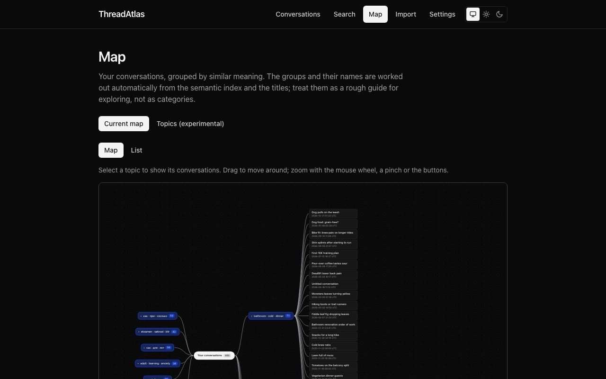 **02** One topic opened: zoomed out to 0.4×, so the titles are unreadable; mixed subjects. |
| 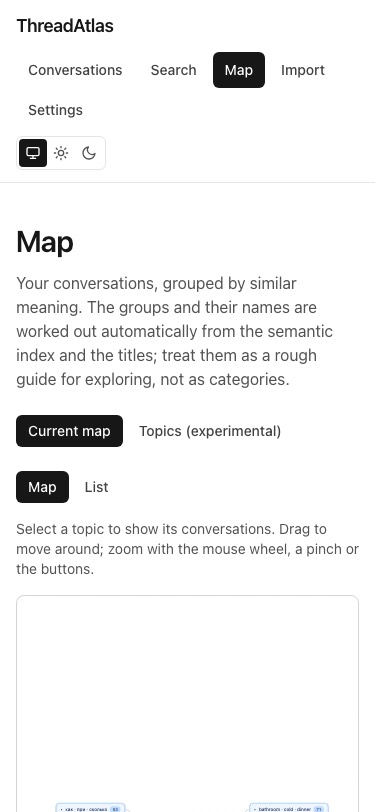 **03** 375 px: the header takes 3 rows and the map begins at 595 px. | 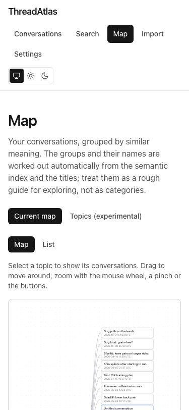 **04** 375 px, topic open. |
| 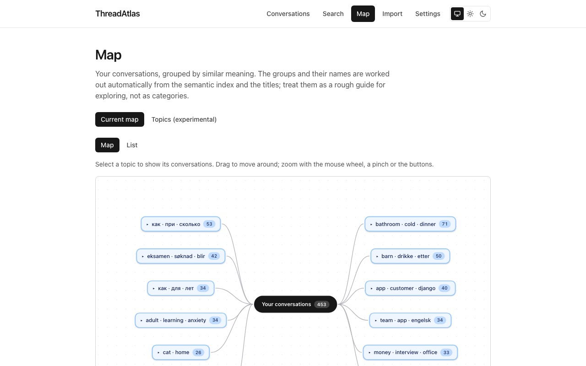 **05** After 15 Tab presses, focus is on an edge ("Edge from root to topic:t1"); nothing on screen shows it. | 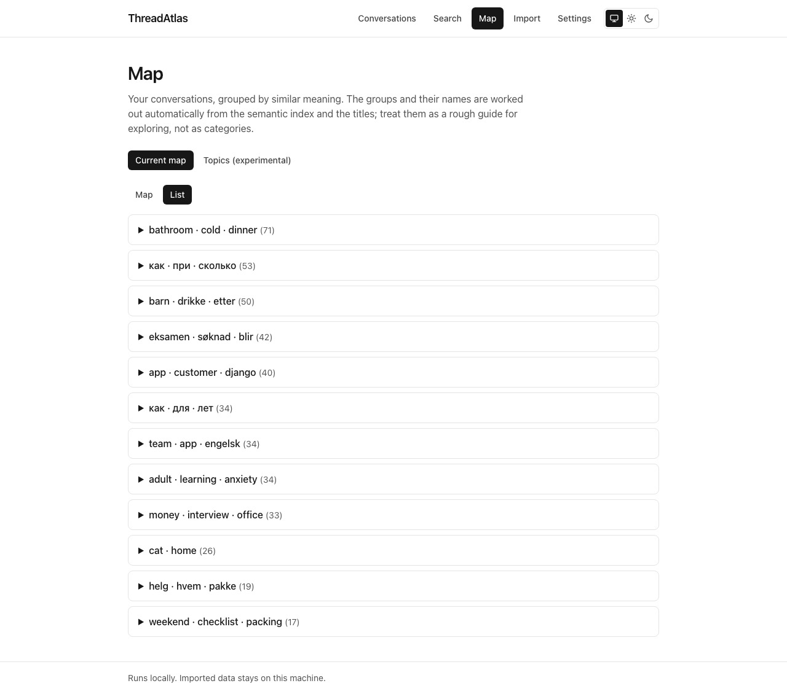 **06** The list view: accessible and solid, with the same weak labels. |
| 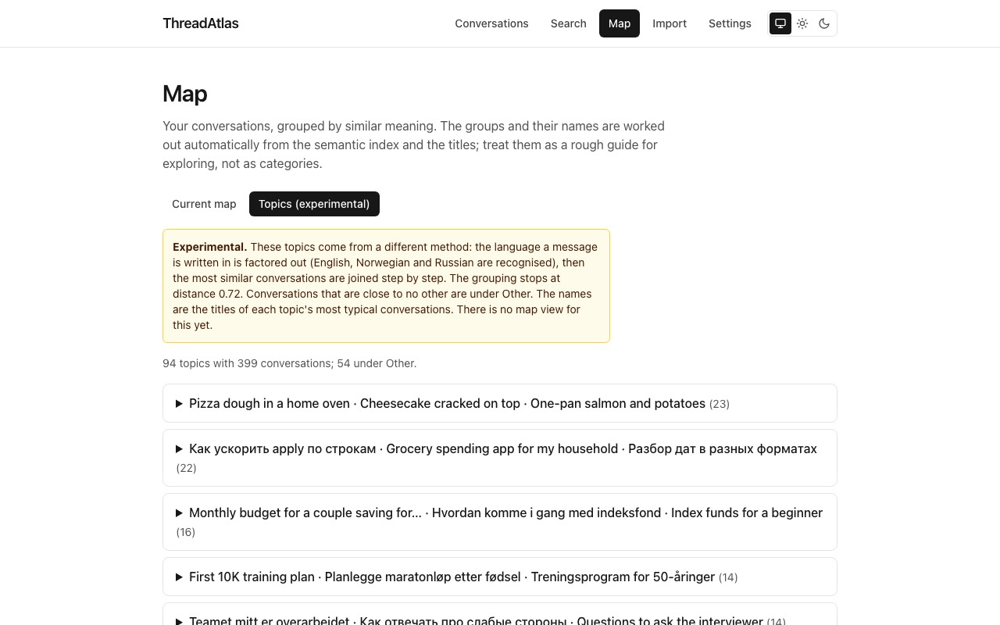 **07** Experimental Topics: cross-language groups that make sense, but 94 flat rows behind a paragraph of method. | 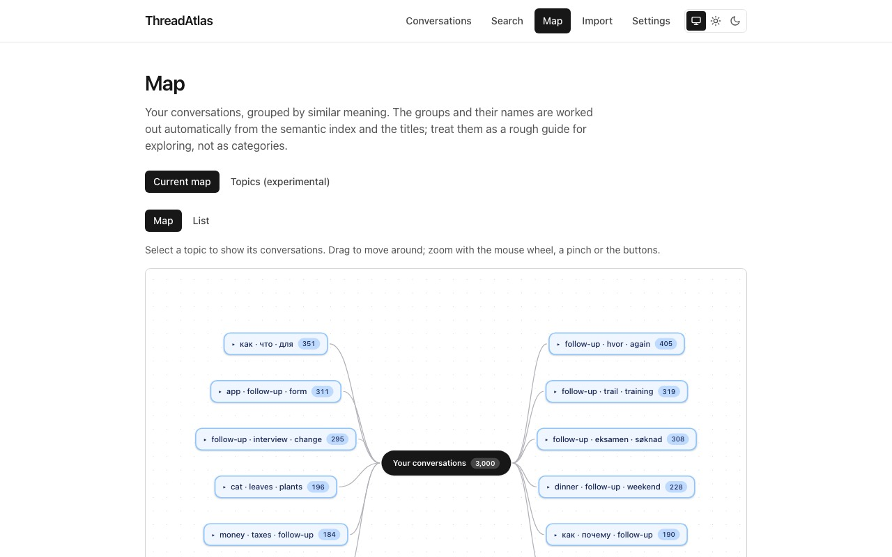 **08** 3,000 conversations: still 12 topics (the "follow-up" labels come from the synthetic copies). |
| 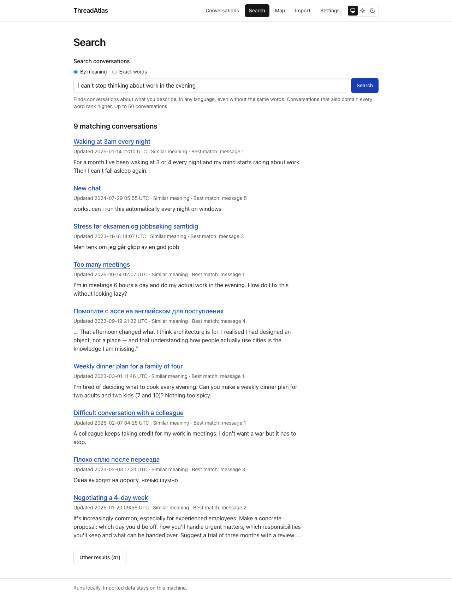 **09** Search by meaning: readable, but about 3 results per screen, every one "Similar meaning". | 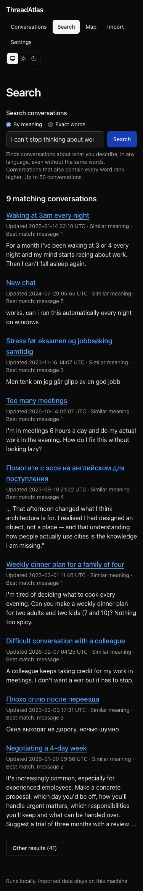 **10** Search, 375 px, dark. |
| 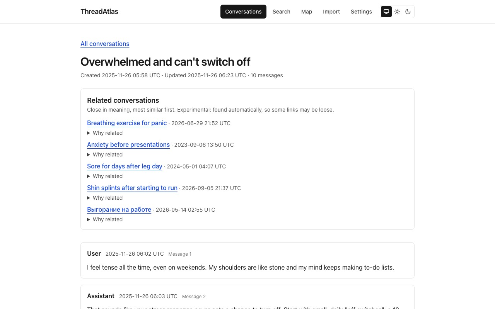 **11** Conversation: related conversations come first; the messages start at 627 px. | 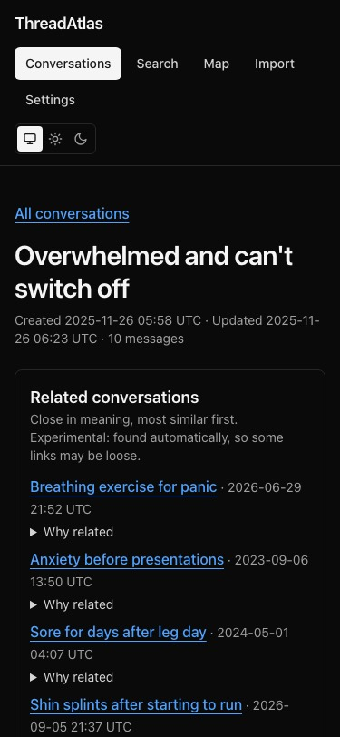 **12** 375 px, dark: no message on the first screen. |
| 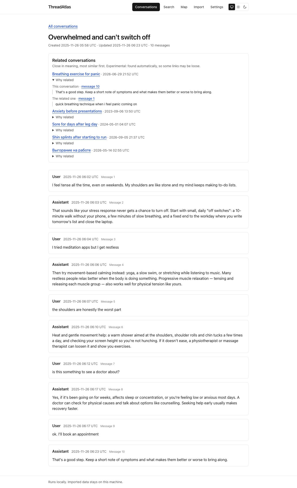 **13** "Why related" open; one card per message. | 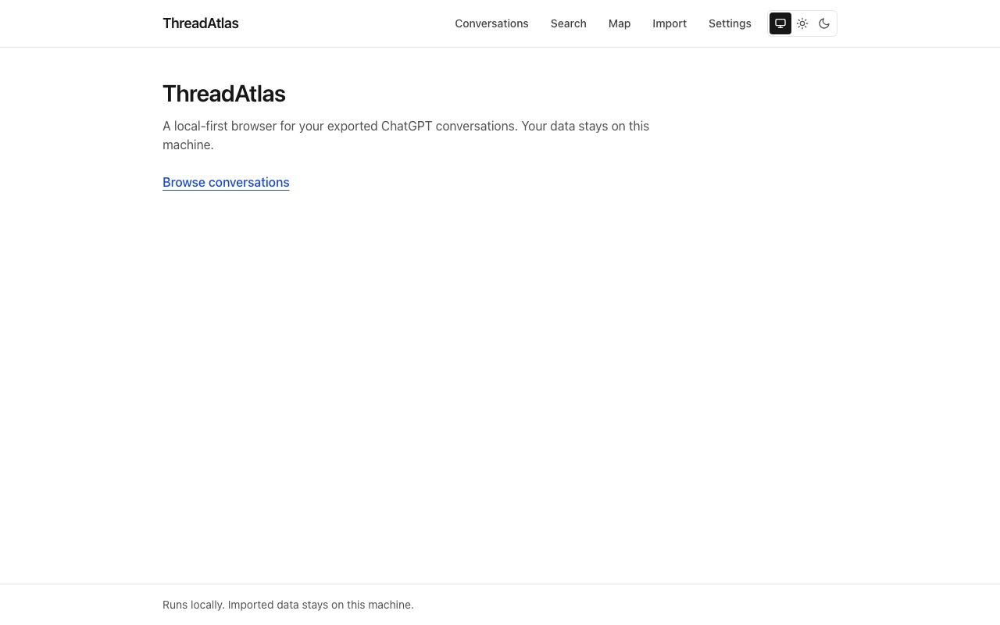 **14** Home on an empty archive: one link. |
| 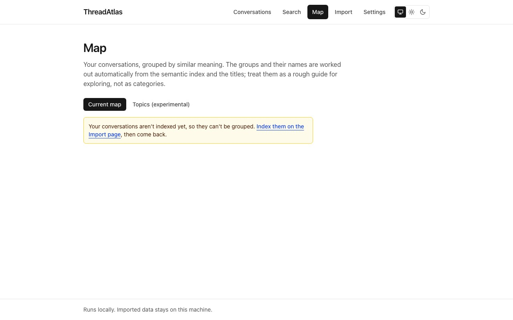 **15** Map before indexing: a clear note and link. | 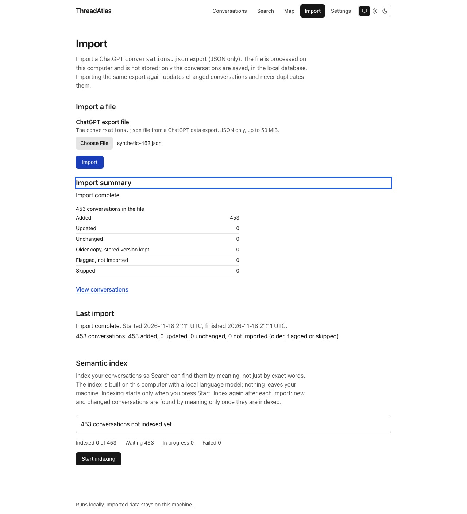 **16** After import: the next step offered is "View conversations"; indexing is further down. |
| 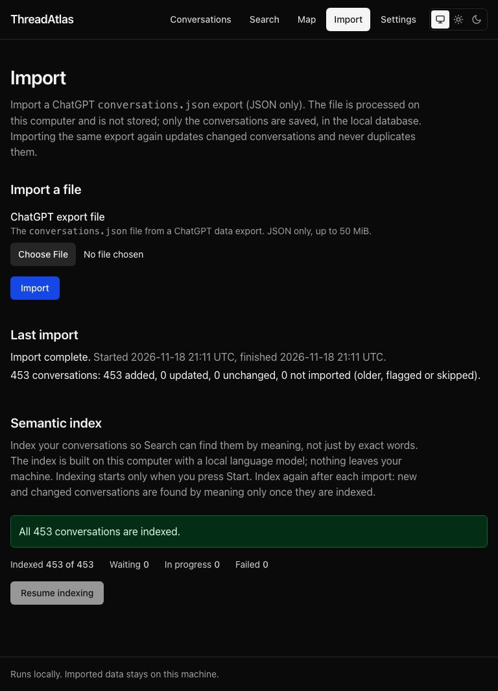 **17** Import and index, 768 px, dark. | 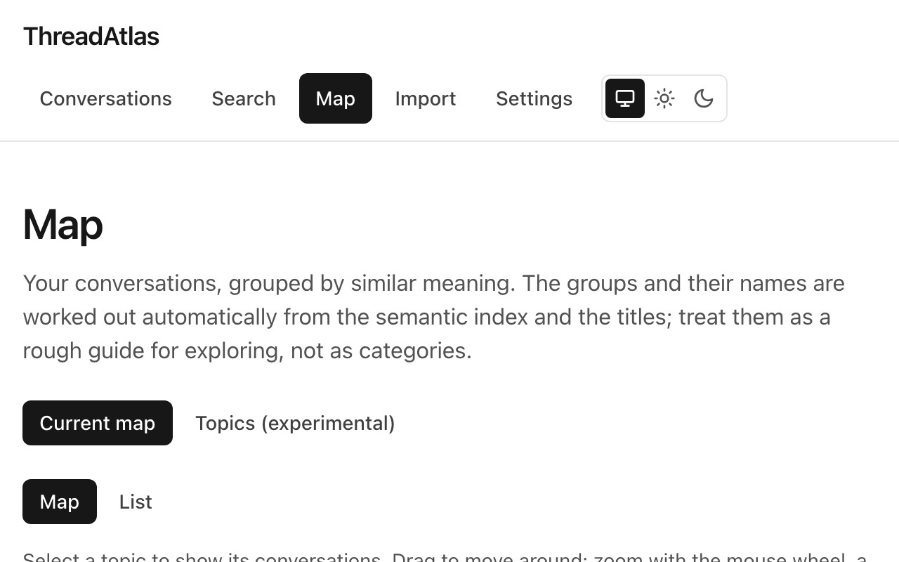 **18** 200% zoom: the map isn't on the first screen at all. |

## Proposed visual direction (frontend-design)

Process: Anthropic's frontend-design skill, used as guidance from the verified copy (not
installed). It works in two passes: plan the tokens, then review the plan against the brief
and against its list of generic defaults.

### Brief

ThreadAtlas is a private, local reading and exploration tool for one person's ChatGPT history:
hundreds to thousands of conversations in several languages. Its main job is
**rediscovery**: "what did I work out about X, and what else is it connected to?". It's used
in long, calm sessions, often with a keyboard. It is not a marketing site, and there's no hero.
Everything must work offline under the existing CSP: no remote fonts or assets.

### Concept: an atlas of your own thinking

The product's name already supplies the vocabulary: an atlas has **plates** (the map), a
**gazetteer** (the index of places, which here is the outline/list), **legends**, and the
habit of telling you exactly where you are. The concept is used structurally, not as
decoration:

- the outline is the map's legend and its accessible equivalent at the same time;
- every page says where you are (Atlas, then topic, then conversation);
- the map is **the one memorable element**; everything around it stays quiet.

### Tokens (first pass)

| Role | Light | Dark | Use |
| --- | --- | --- | --- |
| Ground | `#F6F7F8` | `#12171D` | page background (cool, not cream) |
| Surface | `#FFFFFF` | `#1A2129` | panels, reading column |
| Ink | `#1C2530` | `#E6EAEE` | text; 15.5:1 / 13.4:1 on surface |
| Muted ink | `#586474` | `#9AA6B3` | metadata; 6.0:1 / 6.6:1 |
| Route (accent) | `#1D5C86` | `#7DB8E0` | links, focus, the selected topic; 7.2:1 / 7.6:1 |
| Marker | `#F3D98B` | `#6B5A1F` | search highlights; ink on marker 11.1:1 / 5.6:1 |

Topic regions on the map use a small set of low-chroma tints that never carry meaning alone:
every region is labelled, and the selection is also shown by outline weight.

- **Type: system fonts only.**
  - UI and data: `system-ui` with tabular figures for counts and dates.
  - **Reading text** (messages, passages): a system serif stack (`Charter, "Iowan Old Style",
    Georgia, serif`) at 17/1.6, at most 68 characters a line. The transcript then reads like a
    document, and the controls around it read like controls.
  - Code: `ui-monospace`.
  - Scale: 13, 15, 17, 21, 26, 32.
- **Layout:** an application shell up to about 1,440 px wide, left-aligned throughout.
  - Atlas: outline on the left, map in the centre, the selected topic's list on the right
    (wireframe A).
  - Conversation: reading column with a "Nearby" rail (wireframe B).
  - Search: one column of compact rows.
  - Corner radius by hierarchy: 4 px for controls, 8 px for panels, 12 px for the map frame
    only.
- **Motion:** only in response to an action, such as opening a topic or panning to it. None
  under reduced motion.

### Review against the brief and the skill's list of defaults, with changes

- **" · " metadata strings** (the skill lists them as a templated tell), used in 7 files
  today. → Changed: metadata goes in aligned columns (date, count, language). Middle dots
  stay only inside the experimental topic names, where they separate titles.
- **The card kit** (identical rounded cards with the same shadow), which messages, results and
  related items use today. → Changed: a transcript and rows separated by spacing; borders only
  where they mean "this is a separate region" (the map frame, the side panels).
- **Serif type on a warm cream ground** is the skill's first listed cliché. → Kept the serif
  for reading text only, on a cool ground, with no warm accent.
- **A broadsheet look with hairline rules** is the tempting reading of "atlas". → Avoided:
  rules appear only between rows of the outline; the type stays sans-serif outside the
  reading text.
- **All-caps labels and "→" on links** appeared in the first wireframe draft ("GAZETTEER",
  "Show all →"). → Removed: sentence case throughout.
- **The numbered steps** in wireframe C stay: first run really is a sequence, which is the
  skill's own test for numbering.

### Principles

1. Your conversations are the loudest thing on screen; the interface is quiet.
2. One bold element: the map.
3. Always show where you are and how you got there (breadcrumb, `?topic=`, Back restores).
4. Explain the machine in plain words: why grouped, why related, why matched.
5. State the privacy promise once, where it matters (import and indexing), not as decoration.

## Wireframes
### Wireframe A — Atlas home (map first), desktop ≥ 1024 px

`/` once anything is indexed. The gazetteer (left) is the accessible list and the map's legend at
once; the plate (right) shows the selected topic. `?topic=` holds the selection, so Back and
reload restore it.

```
┌──────────────────────────────────────────────────────────────────────────────────────────┐
│ ThreadAtlas      Atlas  Conversations  Search  Import  Settings              [⌕ Search…] │
├──────────────────────┬────────────────────────────────────────┬──────────────────────────┤
│ Topics               │                                        │ Sleep and evening stress │
│ [Filter topics…    ] │          ╭─────────╮                   │ 31 conversations         │
│                      │     ╭────┤ Running ├──╮                │ English 14, Norwegian 9, │
│ Sleep & stress   31 ◀│     │    ╰─────────╯  │   ╭────────╮   │ Russian 8                │
│ Running          24  │ ╭───┴──────╮   ╭──────┴───┤ Money  │   │ Overwhelmed and can't    │
│ Home renovation  22  │ │ Sleep &  │   │  Your    │        │   │ switch off       2026-03 │
│ Money            21  │ │ stress ● │───│ archive  ╰────────╯   │ Søvn og trening om       │
│ Food at home     20  │ ╰──────────╯   │  453     │            │ kvelden          2025-11 │
│ …                    │      ╭─────────┴╮         │            │ Плохо сплю после         │
│ Unsorted         38  │      │ Code     │    ╭────┴─────╮      │ переезда         2025-02 │
│                      │      ╰──────────╯    │ Travel   │      │ …                        │
│ 453 conversations,   │                      ╰──────────╯      │ Show all 31 in the list  │
│ 440 indexed          │  [＋][－][⤢]  Keys: Tab topics, Enter  │                          │
│ View: Map | Outline  │  opens, Esc closes                     │                          │
└──────────────────────┴────────────────────────────────────────┴──────────────────────────┘
```

Tablet (768): gazetteer collapses into a top "Topics" select/disclosure; the plate becomes a
bottom sheet. Mobile (< 640): the **outline is the default** (gazetteer + plate as one list),
with "Show map" as a secondary view.

### Wireframe B — Conversation with "Nearby" rail, desktop and mobile

Reading column ≤ 70 characters, transcript instead of one card per message, related
conversations in a rail that stays visible while reading.

```
Desktop ≥ 1024 px
┌────────────────────────────────────────────────────────────┬───────────────────────────┐
│ Atlas › Sleep and evening stress › Overwhelmed and can't…  │ Nearby                    │
│                                                            │ Close in meaning; may be  │
│ Overwhelmed and can't switch off                           │ loose. Why? ▸             │
│ 10 messages     March 2026     English                     │                           │
│                                                            │ Stress før eksamen og     │
│ You                                              14:02     │ jobbsøking samtidig       │
│ ┃ I keep replaying work conversations in bed and can't…    │   Norwegian, 8 messages   │
│                                                            │   ▸ Why related           │
│ ChatGPT                                                    │ Søvn og trening om        │
│   What you're describing is common when the day never…     │ kvelden                   │
│   (serif reading text, 16/1.6, max 68ch)                   │ Стресс из-за ремонта      │
│                                                            │ соседей                   │
│ You                                              14:09     │                           │
│ ┃ …                                                        │ Show these on the map     │
│                                      [ Messages 1–10 ]     │                           │
└────────────────────────────────────────────────────────────┴───────────────────────────┘

Mobile < 640 px
┌──────────────────────────────┐
│ ‹ Sleep and evening stress   │
│ Overwhelmed and can't…       │
│ 10 messages      March 2026  │
│ [ Nearby (3) ▾ ]             │  ← collapsed by default; messages come first
│ You                          │
│ ┃ I keep replaying work …    │
│ ChatGPT                      │
│   What you're describing …   │
└──────────────────────────────┘
```

### Wireframe C — First run (empty archive → explore)

`/` before any import. One page, three steps that tick themselves off from real state; each
step says what happens on this computer.

```
┌──────────────────────────────────────────────────────────────────────────────┐
│ ThreadAtlas      Atlas  Conversations  Search  Import  Settings              │
├──────────────────────────────────────────────────────────────────────────────┤
│ Map your ChatGPT history, on this computer                                   │
│ Nothing is uploaded. The app has no network code; the model runs locally.    │
│                                                                              │
│ 1 ✓ Get your export        ChatGPT → Settings → Data controls → Export.      │
│                            You'll get a .zip by email; unzip it and find     │
│                            conversations.json.                               │
│ 2 ● Import it              [ Choose conversations.json ]   up to 50 MiB      │
│                            Re-importing later updates changes, no duplicates │
│ 3 ○ Index for meaning      Needs the local model (once):                     │
│                            npm run model:fetch   ← copy button               │
│                            then [ Start indexing ]   about 4 min per 3,000   │
│                                                                              │
│ Then explore: the Atlas, Search by meaning, Related conversations            │
└──────────────────────────────────────────────────────────────────────────────┘
```

The numbers are a real sequence here, so numbered steps are justified (frontend-design's rule).

## Candidate changes before publication

Small slices, ordered by value for effort. None is started.

1. **Map keyboard and state** (M2, M3, M4's reduced motion): turn off focusable edges and
   wrappers, add `ariaLabelConfig`, put `?topic=` in the URL and restore it on Back, and stop
   the animation under reduced motion. Tests: extend `e2e/map.spec.ts`. *S–M.*
2. **Conversation layout** (C1, C4): a "Nearby" rail on wide screens, collapsed on mobile, and
   a breadcrumb. *M.*
3. **First-run path** (F1–F4): a state-aware home page with the three steps, a "Next: index"
   prompt after an import, and an up-front model check. *M.*
4. **Tokens and shared components** (P3): `Link`, `Button`, `Note`, theme tokens, and the
   dark-mode contrast fix. This makes 1–3 cheaper and keeps them consistent. *M.*
5. **Search rows** (S1, S2): compact rows and labelled match tiers. *S–M.*
6. **Map data and layout** (M1, M5, M6, M7): the two-level language-corrected topics, the
   three-panel atlas, outline-first on mobile, and caching. This needs your decision on M1
   first; it's the largest change and the one that makes "map first" real. *L.*

A reasonable pre-publication set is 1, 4 and 3, with 2 if time allows; 6 after the M1
decision.

## Appendix A — Guideline audit (pinned Vercel rules + React Flow checklist)

Skill: `.claude/skills/web-interface-review/` (rules at `vercel-labs/web-interface-guidelines@434b7f9`).
Scope: `src/app/**/*.tsx`, `src/components/**/*.tsx`, `src/app/globals.css`. Not applicable here:
images, video, GIFs, preconnect/fonts (no remote assets by design).

### src/app/layout.tsx
- `layout.tsx:36,53,59` - one `max-w-4xl` (896 px) container for every page, including the map; wide screens get a narrow map and no room for side panels
- `layout.tsx:19` - no `<meta name="theme-color">` for light/dark
- `layout.tsx:53` - `focus:outline-none` on `<main tabIndex=-1>` (skip-link target; acceptable, but no visible cue after "Skip to content")

### src/app/page.tsx
- `page.tsx:3-20` - home is a title, one sentence and one link; no state-aware next step (empty → import, imported → index, indexed → map)

### src/app/map/topic-map.tsx
- `topic-map.tsx:133` - expanded topics live in `useState`; lost on Back from a conversation and on reload (URL should hold the selection)
- `topic-map.tsx:153` - `fitView({ duration: 400 })` ignores `prefers-reduced-motion` (confirmed: the viewport still animates with reduced motion on), and opening a 71-conversation topic zooms out to 0.4×, so its titles render at about 5 px
- `topic-map.tsx:158-172` - `edgesFocusable` and `nodesFocusable` left at their defaults: the 12 edges are the first 12 Tab stops inside the map, announced as "Edge from root to topic:t1" (internal ids) with no visible focus; then every topic takes two stops (React Flow's wrapper `div[tabindex=0]` and the inner `<button>`). Confirmed in the keyboard walk
- `topic-map.tsx:158` - no `ariaLabelConfig`: screen readers hear React Flow's defaults, "Press enter or space to select a node. You can then use the arrow keys to move the node around. Press delete to remove it…", none of which applies here
- `topic-map.tsx:104` - Tab order follows the alternating right/left layout, not reading order
- `topic-map.tsx:55` - topic labels truncate at 18 rem with no full-text affordance besides `aria-label`
- `topic-map.tsx:181` - canvas `h-[70vh] min-h-[28rem]`: at 375×812 the map fills the screen and captures touch panning; no list-first default on mobile
- `topic-map.tsx:37-39` - root node "Your conversations" is not interactive (no fit-all / overview action)

### src/app/map/page.tsx
- `page.tsx:127-141,164-171` - two stacked tab rows ("Current map | Topics (experimental)" then "Map | List"); the mode names describe implementation, not what the user gets
- `page.tsx:185` - instructions cover mouse and touch only; no keyboard instructions
- `page.tsx:71-75` - experimental-topics note is a 4-line paragraph of method detail before any content

### src/app/search/search-form.tsx
- `search-form.tsx:177` - submit disabled until hydration with no explanation (known; brief)
- `search-form.tsx:165-176` - no placeholder/example query; mode help text is the only guidance
- `search-form.tsx:262,279` - every result `space-y-6` with title (text-lg), meta line and snippet: about 3 results per desktop screen, 2 on mobile
- `search-form.tsx:337-353` - meta line packs up to five facts joined by " · " ("Updated …", "Title match", "3 matching messages", "Best match: message 7"); the match reason is buried
- `search-form.tsx:267-277` - "Other results (N)" collapsed button: purpose of the split (close vs. weaker) isn't stated
- `search-form.tsx:31` - deliberate: query kept out of the URL (privacy, A101–A104). Keep; this overrides the "URL reflects state" rule

### src/app/conversations/[id]/page.tsx and related-conversations.tsx
- `[id]/page.tsx:118` - related conversations render *above* the messages: on mobile the first message starts below a full screen of related links
- `related-conversations.tsx:88` - bordered box with an h2, a disclaimer and up to five items each with a "Why related" disclosure; no link to see them on the map
- `related-conversations.tsx:72` - "Why related" `summary` has no hover state and small (text-sm) hit target
- `[id]/page.tsx:77-81` - "All conversations" is the only way back; no breadcrumb to the topic or search the user came from

### src/components/message-view.tsx
- `message-view.tsx:17-20` - every message is an identical bordered card; user and assistant turns differ only by the heading word
- `message-view.tsx:31` - `text-xs text-neutral-500` without a dark variant: 4.2:1 on neutral-950 (below 4.5:1)
- `message-view.tsx:54` - Markdown shown raw (```` ``` ````, `**`, lists) — known limitation; biggest reading-comfort issue on long answers

### src/components/page-nav.tsx
- `page-nav.tsx:30,42` - disabled "Newer/Older" shown as `aria-hidden` grey text (`neutral-500`, 4.2:1 in dark)
- `page-nav.tsx:34` - `aria-current="page"` on a non-link span

### src/components/empty-state.tsx
- `empty-state.tsx:13,16` - fixed `id="empty-state-title"`: duplicate ids if two empty states render

### src/app/import/*
- `import-form.tsx:139` - "Import summary" is an `h2` inside the "Import a file" `h2` section (should be `h3`)
- `import-form.tsx:143-150` - after a successful import the only next step is "View conversations"; indexing (needed for map, meaning search, related) is further down the page and not mentioned
- `import/page.tsx:43-53` - "Semantic index" explains itself in a 3-sentence paragraph; the model must already be downloaded (`npm run model:fetch`), which the page states only after Start fails
- `import-form.tsx:110` - file input uses the browser's default control; no drop target (fine), no hint where to find `conversations.json`

### Site-wide
- `LINK` class string duplicated in 10 files; button styles in 3 (`search-form.tsx:42`, `data-panel.tsx:21`, `import-form.tsx:116`); amber note style in 5 — no shared tokens or components
- Dates everywhere are `YYYY-MM-DD HH:MM UTC` (`display.ts:33`): unambiguous and hydration-safe, but hard to scan and not local time
- " · " meta strings in 7 files (frontend-design lists these as a templated tell; they also hide structure from screen readers)
- No `content-visibility`/virtualisation for long lists; acceptable at 20–50 items per page, see large-archive measurements

## Appendix B — Reproducing the baseline

The walkthrough scripts aren't committed: they drive a temporary review server and aren't part
of the test suite. The procedure:

1. Build the synthetic exports from `docs/spikes/mindmap/v2/conversations.json` (regenerate
   it with `node docs/spikes/mindmap/v2/build.mjs`). Each conversation becomes a linear
   ChatGPT mapping with synthetic timestamps; the large archive adds scaled copies.
2. `npm run build`, then for each archive start `next start` on a fresh temporary database with
   `THREADATLAS_TEST=1` (the isolation guard then requires the system temp folder),
   `DATABASE_URL=file:<tmp>/review.db`, `THREADATLAS_MODEL_DIR=<model folder>`, after
   `npm run db:deploy`.
3. Import and index through the UI, then capture each page at 375, 768 and 1280 px in light and
   dark with Playwright, blocking any request that isn't to the review server.
